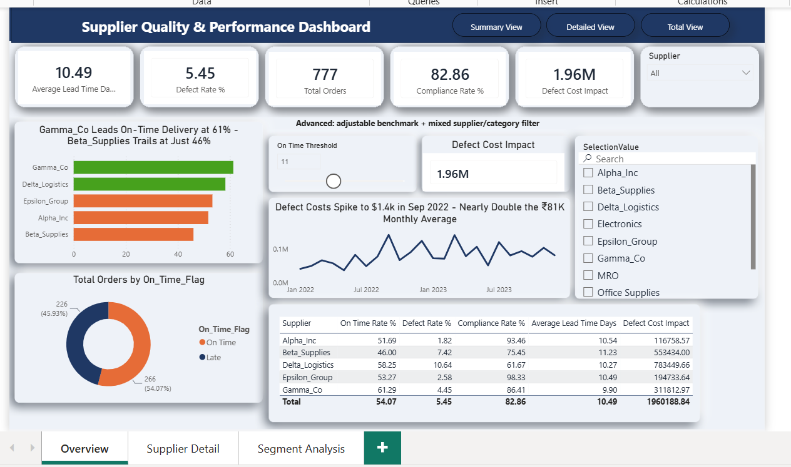
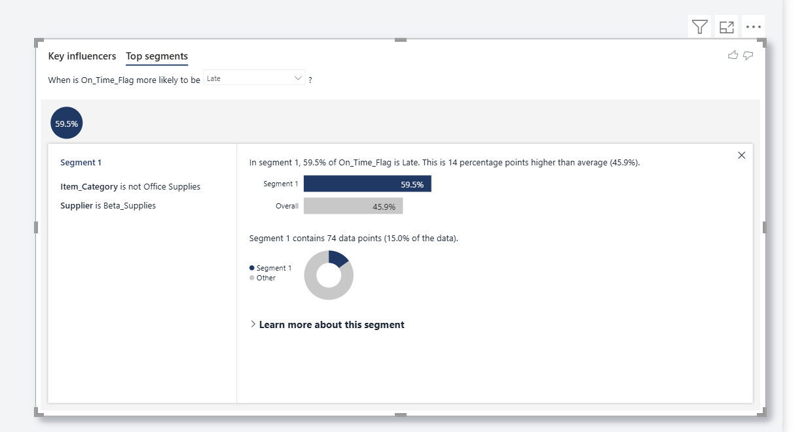

# Supplier Quality & Performance Analysis

📄 [Case Study Report](reports/Supplier_Quality_Performance_Dashboard_Writeup.docx) | 🗃️ [SQL Queries](sql/procurement_analysis.sql) | 📈 [Excel Analysis](excel/Vendor_Scorecard_Composite_Ranking.xlsx) | 📊 [Power BI Dashboard](dashboard/Supplier_Quality_Performance_Dashboard.pbix)

A SQL, Excel and Power BI vendor scorecard that ranks 5 suppliers on delivery, quality and compliance, and shows how much defects cost the business.

---

## Business Problem

Procurement teams buy from multiple suppliers, but without a consolidated view, quality problems, late deliveries and compliance gaps go unnoticed until they cost money. This project combines purchase-order data into one dashboard so a procurement team can see which suppliers are reliable and which are hurting cost and delivery performance.

**Hypothesis:** a small subset of suppliers causes a disproportionate share of defects, late deliveries and compliance failures, so procurement can act on 2-3 suppliers instead of treating the whole vendor base as one risk pool.

## Key Insights

- Across 560 delivered orders: defect rate 5.45%, compliance rate 82.86%, on-time rate 54.07% (11-day threshold) and average lead time 10.49 days. Total defect cost impact is 1.96M.
- **Delta_Logistics** is the clearest underperformer: highest defect rate (10.64%, about 2x the average), lowest compliance (61.67%) and the largest defect cost (783K, about 40% of the total).
- **Beta_Supplies** is the delivery problem: lowest on-time rate (46.00%), longest lead time (11.23 days) and second-highest defect cost (553K).
- Delta_Logistics and Beta_Supplies together cause about 68% of defect cost (1.34M), so 2 of 5 suppliers drive most of the loss.
- Top Segments analysis found one pocket: 74 Beta_Supplies orders outside Office Supplies are late 59.5% of the time, versus 45.9% overall.
- **Epsilon_Group** and **Alpha_Inc** lead on quality and compliance (defect rate below 2.6%, compliance above 93%); **Gamma_Co** leads on speed (61.29% on-time, 9.90 days).
- Average negotiated discount is flat across suppliers (7.8%-8.2%), so the business is not being compensated in price for the risk from weaker suppliers.
- Raw Materials and MRO carry the highest defect rates (6.28% and 4.94%).

## Supplier Scorecard

| Supplier | Defect Rate % | Compliance % | On-Time % | Avg Lead Time (days) | Defect Cost Impact | Composite Score |
|---|---|---|---|---|---|---|
| Epsilon_Group | 2.58 | 98.33 | 53.27 | 10.49 | 194,734 | 79.37 |
| Gamma_Co | 4.45 | 86.41 | 61.29 | 9.90 | 311,813 | 78.94 |
| Alpha_Inc | 1.82 | 93.46 | 51.69 | 10.54 | 116,759 | 78.20 |
| Delta_Logistics | 10.64 | 61.67 | 58.25 | 10.27 | 783,450 | 70.42 |
| Beta_Supplies | 7.42 | 75.45 | 46.00 | 11.23 | 553,434 | 70.31 |

Composite Score weights: On-Time 30%, Defect Rate 40%, Compliance 20%, Lead Time 10%. Lead time has a low weight because "on-time" is already defined from lead time, so a higher weight would count the same signal twice. The Excel scorecard uses min-max scaling (0-100) and shows wider gaps: Gamma_Co 81.1, Epsilon_Group 76.1, Alpha_Inc 74.0, Delta_Logistics 31.0, Beta_Supplies 20.7.

## Dashboard Preview

### Overview

### Supplier Detail

### Segment Analysis

## Business Questions

1. Which suppliers consistently underperform on quality, lead time and compliance, and what does it cost?
2. How much of the defect cost is concentrated in a few suppliers or categories?
3. Are the same suppliers the worst across defect rate, compliance and on-time delivery?
4. Is the business getting a better price from suppliers with worse performance?

## Business Recommendations

1. **Put Delta_Logistics on a corrective-action plan** tied to defect rate and compliance. Its 783K defect cost justifies supplier-quality effort here first.

2. **Investigate Beta_Supplies delivery:** check whether late orders are a lead-time planning or a capacity issue, especially for non-Office-Supplies items (59.5% late).

3. **Use Epsilon_Group (quality, compliance) and Gamma_Co (speed) as benchmarks.** Neither charges a price premium, which supports shifting volume to them after checking capacity.

4. **Review Raw Materials and MRO sourcing,** where defect rates are highest, to check for specification or incoming-inspection gaps.

5. **Use the supplier scorecard in monthly reviews** to track on-time, defect rate, compliance and lead time.

## Dataset

- **Source:** [Kaggle: Procurement KPI Analysis Dataset](https://www.kaggle.com/datasets/shahriarkabir/procurement-kpi-analysis-dataset)
- 777 purchase orders, 5 suppliers, 5 item categories (Electronics, MRO, Office Supplies, Packaging, Raw Materials), Jan 2022 to Jan 2024
- Order status: 560 Delivered (72%), 81 Pending, 73 Partially Delivered, 63 Cancelled
- "On time" means delivered within 11 days of the order date (the median delivery time)

## Method

1. **SQL (PostgreSQL):** data quality checks (order status, duplicates, missing values), then supplier KPIs (orders, on-time, defect and compliance rates, lead time, defect cost), a combined scorecard query, and CTE and window-function queries for supplier ranking and cumulative defect cost.
2. **Excel:** normalised the KPIs and built the weighted composite scorecard.
3. **Power BI:** built the data model and rebuilt all KPIs as DAX measures in a dedicated `_Measures` table. Three pages: Overview, Supplier Detail (gauge) and Segment Analysis (Key Influencers and Top Segments).

Key measures: Defect Rate % (defective units / total quantity), Compliance Rate % (compliant delivered orders / delivered orders), On-Time Rate %, Average Lead Time (days), Defect Cost Impact (defective units x unit price) and Composite Score.

## Tools & Technologies

- **PostgreSQL:** data quality checks and supplier KPI queries (CTEs, window functions)
- **Microsoft Excel:** normalisation, formulas and vendor scorecard
- **Power BI:** data modelling, DAX, interactive dashboards, Key Influencers

## Limitations

- Public Kaggle dataset used for portfolio purposes; findings describe this data and are not verified business results.
- Quality and delivery KPIs use delivered orders only (560 of 777); on-time analysis uses the 492 orders with usable delivery data.
- Only 5 suppliers, so Key Influencers found no reliable drivers of late delivery.
- The 11-day on-time threshold and the composite weights are judgement calls; rankings were not tested at other thresholds.
- Defect cost uses the list unit price, not the negotiated price.

## Acknowledgements

Built as a guided portfolio project using the Procurement KPI Analysis dataset (Kaggle).

## Author

**Sanskriti Rajpoot** | [LinkedIn](https://www.linkedin.com/in/sanskriti-rajput6)
